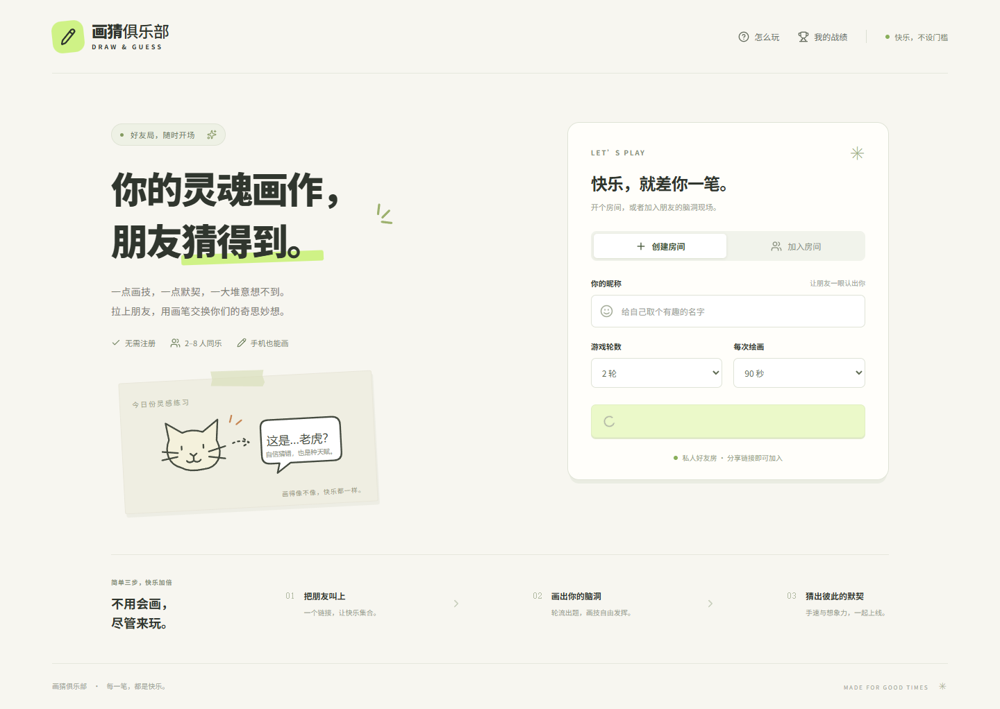

# 画猜俱乐部 · Draw & Guess

一个可以和朋友开房间一起玩的你画我猜游戏。前后端分离，支持实时绘画、猜词计分、轮流出题和断线重连。

**[在线试玩](https://draw.elysium.org.cn)** · [部署指南](docs/deployment.md) · [通信协议](protocol/README.md) · [性能与验证](docs/validation.md)



## 有什么好玩的

- **2–8 人好友房**：输入昵称即可开始，通过房间码或邀请链接加入。
- **轮流当画手**：每人每轮画一次，从三个候选词中选一个，超时自动选词。
- **电脑、手机都能画**：画笔、颜色、粗细、橡皮擦、撤销、清空和 PNG 下载。
- **猜得快，分更高**：实时猜词聊天、回合答案揭晓、最终排名和再来一局。
- **掉线后还能回来**：恢复当前画板，保留座位，房主转移，掉线画手超时跳过。
- **最近战绩**：保存当前访客身份最近 10 场已完成对局。

支持 1–5 轮游戏，每次绘画 30–180 秒。至少两位玩家加入后，由房主开始游戏。

## 技术栈

| 部分 | 实现 |
| --- | --- |
| 前端 | Vue 3、TypeScript、Vite、Canvas 2D、Pointer Events |
| 后端 | Go、标准库 `net/http`、`coder/websocket` |
| 消息编码 | Protobuf 笔迹与快照、JSON 状态与控制消息，兼容旧 JSON 客户端 |
| 数据 | 内存中的房间状态；SQLite 保存访客会话和结算记录 |
| 部署 | Debian、systemd，支持 Caddy 或已有的 Nginx / OpenResty |

后端按房间顺序处理事件，不同房间并发运行。笔迹每 40ms 批量发送，广播复用编码结果；每个连接使用有界发送队列。选词、计时、权限和得分由服务器裁决，答案仅发送给当前画手。

绘画二进制协议的对照测试、生成方式与兼容回退说明见 [Protobuf 对照测试](docs/protobuf-experiment.md)。生成代码已包含在仓库中，正常构建无需安装 Protobuf 编译器。

## 快速开始

需要 **Node.js 22.12+** 和 **Go 1.26+**，并将 `node`、`npm`、`go` 加入 PATH。

```bash
git clone https://github.com/zikun-w/draw-and-guess.git
cd draw-and-guess
```

在两个终端分别启动后端和前端。

**终端一：**

```bash
cd backend
go run ./cmd/server
```

**终端二：**

```bash
cd frontend
npm ci
npm run dev
```

打开 **http://127.0.0.1:5173**，创建房间并邀请朋友。前端开发服务默认仅监听本机地址；线上邀请使用已部署的站点链接。

本机测试两位玩家时，请使用不同浏览器或独立无痕窗口。同一浏览器的标签页会共用身份，在同一房间后打开的页面会接管连接。

Windows 也可以在安装前端依赖后，从项目根目录的两个 PowerShell 终端分别运行：

```powershell
.\scripts\dev.ps1 -Backend
.\scripts\dev.ps1 -Frontend
```

## 配置

后端读取进程环境变量，默认数据库为后端工作目录下的 `data/game.db`。生产配置示例见 [deploy/game.env.example](deploy/game.env.example)。

| 变量 | 默认值 | 作用 |
| --- | --- | --- |
| `LISTEN_ADDR` | `127.0.0.1:8080` | 后端监听地址 |
| `DATABASE_PATH` | `data/game.db` | SQLite 数据库路径 |
| `COOKIE_SECURE` | 未启用 | HTTPS 部署时设置为 `true` |
| `TRUST_PROXY` | 未启用 | 设置为 `true` 后，信任来自 loopback 代理的客户端地址头 |
| `MAX_ROOMS` | `1000` | 房间上限，范围为 1–1000；按资源和压测结果设置 |
| `GOMEMLIMIT` | Go 默认策略 | 可选的 Go 运行时内存软目标，例如 `128MiB` |

## 自己部署

Windows 构建 Linux 发布包：

```powershell
.\scripts\build.ps1 -Architecture amd64
```

Linux / Debian：

```bash
bash scripts/build.sh amd64
```

ARM 服务器将 `amd64` 换成 `arm64`。Windows 打包前先停止前端开发服务，避免 esbuild 文件被占用。

产物位于 `dist/release-时间-架构/`，包含后端二进制、前端静态文件和部署配置；运行服务器无需安装 Node.js 或 Go。

- [单机 Debian 部署](docs/deployment.md)：Caddy 提供 HTTPS，systemd 管理后端。
- [公网入口机 + 内网后端部署](deploy/split/README.md)：复用 1Panel / OpenResty，通过 FRP 转发。

## 检查与测试

后端检查：

```bash
cd backend
go test ./...
go vet ./...
# 竞态检查需要系统安装 C 编译器
go test -race ./...
```

前端生产构建：

```bash
cd frontend
npm run build
```

浏览器测试需要先启动本地前后端，并安装 Microsoft Edge：

```bash
cd frontend
npm run test:e2e
```

测试覆盖完整双人对局、笔迹与撤销同步、刷新重连、答案隔离、结算战绩、手机触摸、无效房间及同一身份接管。也可通过 `E2E_BASE_URL` 指定已部署的站点；浏览器配置见 [playwright.config.ts](frontend/playwright.config.ts)。

回环压测：

```bash
cd backend
go run ./cmd/loadtest -rooms 50 -players 8 -batches 100 -interval 40ms
```

[验证记录](docs/validation.md)包含一组 400 连接的参考结果。压测进程同时运行客户端和服务端，其堆内存不能作为后端的人均内存系数，也不能直接视为 VPS 容量承诺。

## 当前边界

- 房间和进行中的游戏仅保存在内存中，服务重启会结束当前对局；已持久化的会话和战绩保留。
- 访客身份有效期为 24 小时，清除 cookie 或会话过期后，无法自动找回旧身份的战绩。
- 正常停服会等待结算队列写入；强制终止、断电或磁盘异常可能导致未落库的结算丢失。
- 首版按单后端实例设计。多实例部署需要增加房间归属与路由，不能直接将现有实例做随机负载均衡。

## 项目结构

```text
frontend/             Vue 界面、画板、WebSocket 客户端和浏览器测试
backend/cmd/server/   服务入口
backend/cmd/loadtest/ 回环联机压测器
backend/internal/     房间状态机、HTTP、SQLite 和测试
protocol/             HTTP / WebSocket 协议
deploy/               单机和双机部署模板
scripts/              开发与构建脚本
docs/                 部署、验证说明与界面截图
```

## 参与改进

欢迎提交 Issue 描述复现步骤，或通过 Pull Request 改进游戏、词库和文档。涉及玩法、通信协议或权限的变更，请补充对应验证。

## 许可证

本项目采用 [MIT License](LICENSE)。使用、修改或分发时请保留版权及许可声明；第三方依赖保留各自的许可证。
