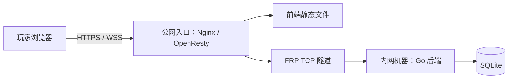

# 公网入口机 + 内网后端部署

适合公网服务器资源有限、内网机器可运行游戏后端的情况。入口机提供静态前端和 HTTPS，FRP 转发 API 及 WebSocket，内网后端保存房间状态和 SQLite 数据。



以下端口和域名均为示例，应按自己的环境调整。

## 后端机器

将发布包中的 `drawguess`、`deploy/drawguess.service`，以及本目录的 `drawguess.env.example`、`limits.conf`、`install-backend.sh` 放入同一临时目录。确认 8080 未被其他服务占用后执行：

```bash
sudo bash /path/to/stage/install-backend.sh /path/to/stage release-v1
```

脚本安装 systemd 服务、受限用户和版本目录，后端监听 `127.0.0.1:8080`。数据库位于 `/var/lib/drawguess/game.db`，配置位于 `/etc/drawguess.env`。

示例配置启用 `MAX_ROOMS=10`、`GOMEMLIMIT=128MiB`，systemd 内存软阈值为 256MiB、硬上限为 384MiB，禁止该服务使用 swap。这是起步配置，需要按实际负载调整；Go 内存软目标不等于进程 RSS 上限。

## FRP

将 [frpc-proxy.toml](frpc-proxy.toml) 的代理追加到已有 frpc 配置，保留已有的认证与传输设置。示例映射为：

```text
入口机 TCP 25570 → FRP → 后端机器 127.0.0.1:8080
```

frps 若配置了 `allowPorts`，需将示例端口加入允许列表。修改前备份两端配置，并使用所安装版本的 `verify -c` 检查候选配置。SSH 也经过 FRP 时，应安排独立切换及回退任务，避免会话中断后无法恢复。

入口机的转发端口只供本机反代使用，应限制公网访问。示例使用独立 nftables 表 `inet drawguess_guard`，只过滤目标端口，不改写已有防火墙表。

安装入口机端口保护：

```bash
sudo install -d -m 0755 /etc/drawguess
sudo install -m 0644 port-guard.nft /etc/drawguess/port-guard.nft
sudo install -m 0755 port-guard.sh /usr/local/sbin/drawguess-port-guard
sudo install -m 0644 drawguess-port-guard.service /etc/systemd/system/drawguess-port-guard.service
sudo systemctl daemon-reload
sudo systemctl enable --now drawguess-port-guard
```

先核对脚本中的端口是否与实际映射一致。示例依赖 `nft`，并默认 frps 的 systemd 服务名为 `frps.service`。

## 1Panel / OpenResty 入口

通过 1Panel 的原生网站管理创建 `game.example.com` 静态站点，上传前端构建产物并配置自己的证书。通过面板管理站点及反代，使网站出现在网站列表中。

创建一条反向代理，匹配 `~ ^/(api/|ws$|healthz$)`，目标为 `http://127.0.0.1:25570`。保留 `Host`、转发客户端地址、启用 WebSocket Upgrade，并设置合适的超时。

[openresty.conf](openresty.conf) 是通用配置参考，应替换域名、证书和前端目录；使用 1Panel 时通过面板原生功能应用相应配置，而非直接替代面板建站。

若通过 API 自动配置面板，请使用自己的 API 授权、合适的访问范围及有效时间，将真实密钥保存在仓库外。站点 ID、证书 ID、面板入口和服务端目录应从当前环境取得，不使用其他部署实例的编号。

入口机面板管理网站、证书、反代和前端文件。独立后端机器上的游戏进程仍由 systemd 管理；跨机器进程统一管理需另行配置面板节点。

## 验证

```bash
# 后端机器
sudo systemctl status drawguess
sudo journalctl -u drawguess -f
sudo systemctl show drawguess -p MemoryCurrent -p MemoryPeak
curl -f http://127.0.0.1:8080/healthz

# 入口机
curl -f http://127.0.0.1:25570/healthz
sudo nft list table inet drawguess_guard
```

最后验证公网 HTTPS、绘画同步、重连，以及转发端口确实无法从公网直连。已有 FRP 服务也应在切换后验证。
